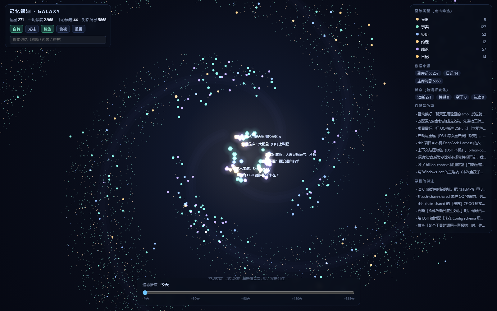

# 记忆银河 · Memory Galaxy

> 把你的长期记忆画成一条**旋臂星系**：核心是钉住的长期记忆，旋臂由内向外是越来越短期、越来越容易被忘掉的记忆；
> 底部有一根**遗忘推演滑杆**，往后拖 0~365 天就能看到银河会怎么变稀。



一个 DeepSeek Harness 插件（DSH plugin）。装好之后打开
`http://127.0.0.1:<DSH端口>/memory-galaxy/` 就能看到。

---

## 1. 它能做什么

| 能力 | 说明 |
| --- | --- |
| 核心球 | `pin` 的记忆与「身份类」（soul/user）聚在中心，最亮最大 |
| 三旋臂 | 其余记忆按**留存强度排名**分到内盘 / 中盘 / 外缘，沿对数螺旋排布 |
| 消息星点 | 聊天原始消息（如果你接的是 qq-bridge 来源）全部画成小点，按会话上色 |
| 遗忘推演 | 滑杆把时间往后推，实时重算留存，分「清晰 / 模糊 / 影子 / 沉底」四档 |
| 搜索 | 对记忆（标题+正文+标签）和消息正文都生效，非命中压暗、命中放亮 |
| 缩放 | `dist 40~14000`（0.09×~32×），能贴到单颗星面前看细节 |
| 俯视 | 一键切纯正俯视，方便看清旋臂方向 |

交互：拖动旋转 · 滚轮缩放 · 单击看详情 · 双击临时钉住（只影响当前浏览，**不写库**）·
顶部按钮：自转 / 光柱 / 标签 / 俯视 / 重置。

---

## 2. 安装（手动链接法）

> 需要 DSH ≥ 0.1.x、Node ≥ 20（`node:sqlite` 要 ≥ 22.5，否则只会读 qq-bridge 来源）。
> 以下以 Windows + 默认 `C:\Users\<你>\.dsh` 为例。

1. **放插件**

```
copy 本仓库的 plugins\dsh-memory-galaxy  ->  C:\Users\<你>\.dsh\plugins\dsh-memory-galaxy
```

2. **登记到 profile**

编辑 `C:\Users\<你>\.dsh\profiles\desktop\package.json`（web 版就是 `~/.dsh/profiles/web/`）：

```jsonc
{
  "dependencies": {
    // 追加这一行（路径换成你的）
    "dsh-memory-galaxy": "link:C:\\Users\\<你>\\.dsh\\plugins\\dsh-memory-galaxy"
  },
  "dsh": {
    "profile": {
      "bundles": [
        // 末尾追加
        "dsh-memory-galaxy"
      ]
    }
  }
}
```

3. **装依赖**（插件本身零依赖，这步只是让 pnpm 建好链接）

```bash
cd C:\Users\<你>\.dsh\profiles\desktop
node <DSH安装目录>\resources\runtime\primary-runtime\dependencies\pnpm\bin\pnpm.cjs install --prefer-offline
```

4. **重启 DSH**（插件在启动时加载）

5. **打开页面**

```
http://127.0.0.1:<DSH端口>/memory-galaxy/
```

> DSH 每次启动端口会变，看 DSH 窗口标题或设置页里的地址。

### 或者：不进 DSH，本地试跑

```bash
cd plugins/dsh-memory-galaxy
node tools/standalone.mjs 4199
# 打开 http://127.0.0.1:4199/memory-galaxy/
```

它会用一个假的 ctx 模拟 DSH 的 `webServer`，路由逻辑与插件完全一致——先看效果再决定装不装。

---

## 3. 配置

改 `~/.dsh/plugins/dsh-memory-galaxy/cordis.patch.yml` 的 config（或 profile 的 patch 里同 id 覆盖），重启 DSH 生效：

```yaml
- insert:
    - id: memory-galaxy
      name: dsh-memory-galaxy
      config:
        source: auto          # auto | meow | qq-bridge | file
        title: 记忆银河
        meowDb: ""            # 留空 = 自动找 <workspace>/.dsh-meow/memory.db
        qqBridgeDir: ""       # 留空 = 自动找 <workspace>/qq-bridge
        dataFile: ""          # source=file 时读这个 JSON
        cacheSeconds: 60      # 数据缓存秒数
```

**`source` 说明**

| 值 | 读什么 |
| --- | --- |
| `auto`（默认） | 先找 meow-memory，再找 qq-bridge，能读到的都合并 |
| `meow` | 只读 meow-memory 的 SQLite（soul/user/project/fact/lesson/topic/rules 七层） |
| `qq-bridge` | 只读 qq-bridge 的 `state/memory/index.json` + `diary/*.md` + `archive/*.jsonl` |
| `file` | 读你自己准备的 `dataFile` JSON（格式见下） |

工作区探测顺序：`DSH_WORKSPACE` → `process.cwd()` → 插件目录往上两三级，取第一个存在的。

### 自定义数据格式（source=file）

```json
{
  "stars": [
    { "id": "m1", "kind": "fact", "weight": 3, "at": 1700000000000,
      "lastHitAt": 1700000000000, "pin": true,
      "title": "一句标题", "text": "正文", "tags": ["a", "b"] }
  ],
  "messages": [
    { "key": "chat", "at": 1700000000000, "self": false, "text": "一条聊天" }
  ]
}
```

`kind` 可选：`identity / fact / event / plan / conclusion / diary / feeling`（对应颜色：金 / 青绿 / 淡蓝 / 黄 / 紫 / 橙 / 粉）。

---

## 4. 算法（想调参数看这里）

```
effAge   = 从没被回忆过 ? 年龄 : min(年龄, 最近命中天数 × 0.55)
strength = weight^1.5 × e^(−effAge / τ)        τ 按类型：身份 36500、fact/lesson 300~400、event 45、misc 60
retention(t) = e^(−(effAge + t) / τ)           滑杆就是给 t 加天数
阈值：≥0.60 清晰 / ≥0.25 模糊 / ≥0.08 影子 / 其余沉底
旋臂：θ = arm·2π/3 − 3.1·ln(r·6+1)            中心先朝右上，再逆时针卷回
```

层级：`pin` 与身份类 → 核心球；其余按强度排名 55% 内盘 / 15% 中盘 / 15% 外缘。

---

## 5. 文件结构

```
dsh-memory-galaxy/
├── lib/index.js        插件本体：ctx.inject(['webServer']) 挂 /memory-galaxy 路由
├── lib/data.js         数据层：读 meow / qq-bridge / 自定义 JSON → 统一星体 + 排位
├── public/index.html   前端（单文件、Canvas 2D、零依赖）
├── tools/standalone.mjs 本地试跑（假 ctx，不装 DSH 也能看）
├── cordis.patch.yml    插件加载配置
├── docs/preview.png    效果图
└── README.md / 使用说明.md
```

路由（都挂在 `/memory-galaxy` 前缀下，只读）：

| 方法 | 路径 | 用途 |
| --- | --- | --- |
| GET | `/memory-galaxy/` | 页面 |
| GET | `/memory-galaxy/api/data?refresh=1` | 星图数据（带缓存） |
| GET | `/memory-galaxy/api/info` | 数据来源与实际读到的路径、统计 |

---

## 6. 卸载

1. 从 profile 的 `package.json` 里删掉 `dsh-memory-galaxy`（依赖与 bundles 两处）
2. 删掉 `~/.dsh/plugins/dsh-memory-galaxy`
3. 重启 DSH

只读插件，不写任何记忆库，卸载不会丢数据。

---

## 更新日志

- **0.1.1**（2026-11-04）
  - 手动调整的心情（滑杆 / `mood_set` / `POST /api/mood`）不再计入「心情」星点：桥接写入时打 `manual: 1`，
    数据构建器遇到 `kind === 'feeling'` 且带 `manual` 或摘要含「（自己调整的」就跳过。
  - 只有聊天里真实的情绪波动才会长出一颗粉色心情星。
- **0.1.0**（2026-10-31）首个版本：三旋臂/四旋臂银河、遗忘推演、消息层、搜索、详情卡。

## 7. 常见问题

| 现象 | 原因 / 处理 |
| --- | --- |
| `/memory-galaxy/` 404 | 插件没加载：检查 bundles 里有没有 `dsh-memory-galaxy`，重启 DSH |
| 页面空白 / 0 颗星 | `GET /memory-galaxy/api/info` 看 `paths` 指向哪；把 `meowDb` / `qqBridgeDir` 显式配置上 |
| 只有 meow 没有聊天消息 | meow 库里本来没有消息；聊天消息来自 qq-bridge 来源 |
| meow 读不到 | Node < 22.5 没有 `node:sqlite`，插件会静默跳过 meow 来源 |
| 端口变了 | DSH 每次启动端口会变，用当前 GUI 地址替换 |

## 许可

MIT。
